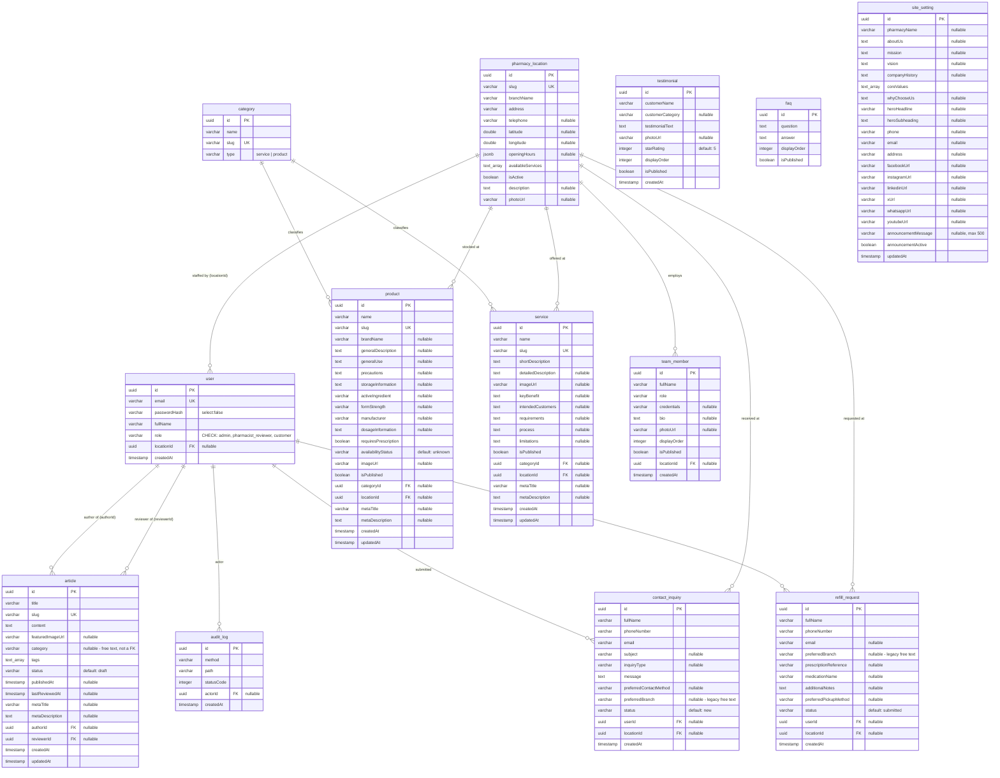

# Entity-Relationship Diagram

The database schema for the Ingata Pharmacy backend, as defined by the 14 TypeORM entities in `src/db/entities/`. Migrations in `src/db/migrations/` own the schema (`synchronize` is permanently `false`), so this diagram must stay in step with both the entities and the migrations — `npm run db:verify` fails if the two ever disagree.

Every primary key is a `uuid` generated by the database. Table names are snake_case (`@Entity("...")`) while column names inside them are camelCase, which is what the existing database already uses.

## Diagram

`site_setting` is intentionally absent from the relationship block: it is a singleton (one row of corporate content) with no foreign keys pointing in or out.

## Foreign keys and delete behaviour

The `onDelete` rule is not uniform — it encodes a deliberate decision per relation about what should happen when the referenced row goes away.

| Child table | Column | → Parent | onDelete | Why |
|---|---|---|---|---|
| `user` | `locationId` | `pharmacy_location` | **RESTRICT** | A branch cannot be deleted while staff are assigned to it; the FK error becomes a clean 409 rather than orphaning an account. |
| `article` | `authorId` | `user` | NO ACTION | Editorial history must not vanish; the user cannot be deleted while they have authored articles. |
| `article` | `reviewerId` | `user` | NO ACTION | Same as `authorId` — a reviewer's decisions stay attributed. |
| `audit_log` | `actorId` | `user` | NO ACTION | The accountability trail must survive; a user with audit entries cannot be deleted. |
| `product` | `categoryId` | `category` | NO ACTION | A category still in use cannot be deleted out from under products. |
| `product` | `locationId` | `pharmacy_location` | NO ACTION | Same, for branches. |
| `service` | `categoryId` | `category` | NO ACTION | Same, for services. |
| `service` | `locationId` | `pharmacy_location` | NO ACTION | Same, for branches. |
| `contact_inquiry` | `userId` | `user` | **SET NULL** | Deleting a customer account must neither be blocked by nor destroy an inquiry they once submitted; it simply becomes unowned. |
| `contact_inquiry` | `locationId` | `pharmacy_location` | **SET NULL** | Retiring a branch must not delete enquiries it received. |
| `refill_request` | `userId` | `user` | **SET NULL** | Same reasoning as `contact_inquiry.userId`. |
| `refill_request` | `locationId` | `pharmacy_location` | **SET NULL** | Same reasoning as `contact_inquiry.locationId`. |
| `team_member` | `locationId` | `pharmacy_location` | **SET NULL** | A member left unassigned is not shown anywhere; retiring a branch must not delete the person. |

The pattern: records that carry **accountability** (articles, audit log) block deletion, while records that represent a **customer's own submission** or **optional association** (inquiries, refills, team members) fall back to null.

## Tables

### `user`

Every account, staff and public alike. `role` is constrained by `CHK_user_role` to `admin`, `pharmacist_reviewer` or `customer`; the constraint is declared in both the entity and migration `AddUserRoleCheckConstraint` so the schema checker does not see it as drift. `passwordHash` is `select: false` — every endpoint that does not explicitly `addSelect` it will not return it (only the login lookup opts in). `locationId` is meaningful only for `pharmacist_reviewer` accounts and scopes their whole `/pharmacist` area.

### `pharmacy_location`

Branch records: address, coordinates, JSON opening hours, and an array of service slugs. Referenced by products, services, team members, inquiries, refills and pharmacist accounts.

### `category`

Shared taxonomy for products and services. The `type` column (`service` or `product`) distinguishes the two uses; `slug` is globally unique.

### `product`

Catalog items. Carries both consumer-facing copy and clinical fields (`precautions`, `storageInformation`, `dosageInformation`, `requiresPrescription`). `availabilityStatus` is free text with a default of `unknown`.

### `service`

Pharmacy services. Richer editorial shape than products: `keyBenefit`, `intendedCustomers`, `requirements`, `process`, `limitations`.

### `article`

Editorial content with a draft → pending_review → approved → published workflow (see the README for the transitions and which role may perform each). `category` here is a plain **string**, not a foreign key to `category` — article categories are editorial labels, separate from the product/service taxonomy. `tags` is a Postgres `text[]`.

### `team_member`

Staff profiles shown on branch pages, ordered by `displayOrder` and gated by `isPublished` (new entries default to unpublished).

### `testimonial`

Customer quotes with a `starRating` (default 5), ordered by `displayOrder`, gated by `isPublished` (default false, so a quote is reviewed before it appears).

### `faq`

Question/answer pairs ordered by `displayOrder`, gated by `isPublished`.

### `contact_inquiry`

Public contact-form submissions. Works without an account, so `userId` and `locationId` are both nullable and only set when the caller was logged in / picked a branch. The free-text `preferredBranch` is retained alongside the `locationId` relation: rows written before that relation existed keep only the text and will not match a pharmacist's branch filter.

### `refill_request`

Prescription-refill submissions, same nullable-owner pattern as `contact_inquiry`. `preferredBranch` is the legacy free-text field; `locationId` is the relational one.

### `audit_log`

Staff-accountability trail: one row per successful staff (`admin`/`pharmacist_reviewer`) create/update/delete, recording method, path and resulting status code. A logged-in `customer` submitting a public form is deliberately **not** logged — this is not a record of routine customer activity.

### `site_setting`

Singleton row holding all corporate content: About Us, mission/vision/values, homepage hero copy, footer contact details, social links, and the single site-wide announcement banner.

## Column type notes

- `text_array` — a Postgres `text[]` column (`{ type: "text", array: true }`), defaulting to an empty array.
- `jsonb` — used only by `pharmacy_location.openingHours`.
- `timestamp` columns use `precision: 6`; `createdAt` defaults to `now()` and `updatedAt` is maintained by `@UpdateDateColumn`.
- Enum-like fields (`user.role`, `article.status`, `product.availabilityStatus`, `category.type`, the various `status` columns) are plain `varchar`, **not** native Postgres enums. Their allowed values are typed as string-union types in `src/types/index.ts`.
